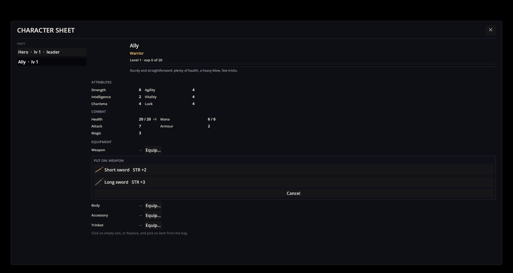
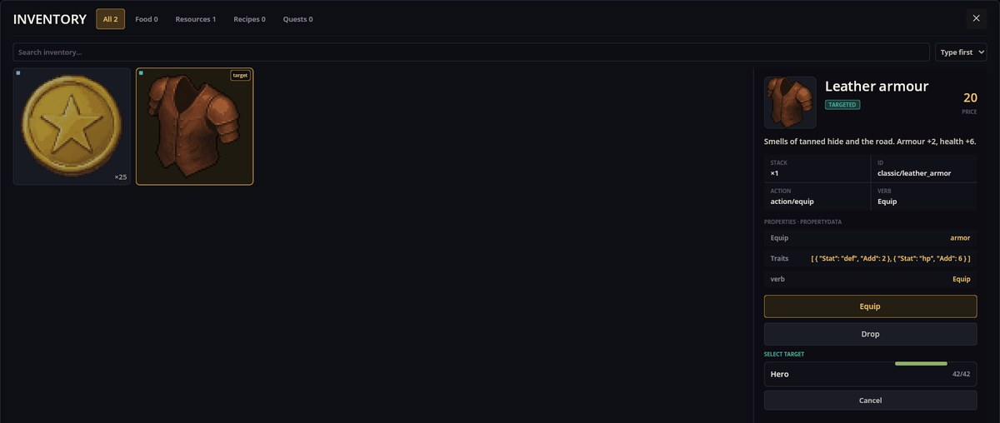
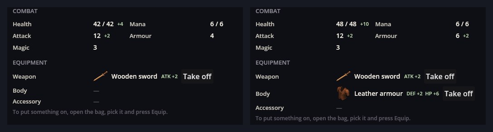

# Equipment —— キャラクターのステータスを変える装備

Equipment でキャラクターは物を身に着けられます。武器、防具、お守り——ビジュアルノベルなら衣装や宝石も。アイテムを装備している間、そのボーナスはキャラクターのステータスに反映され、キャラクターシート、バトル、ステータス判定、条件がすべてすぐに追随します。外すとかばんに戻ります。

Stats Engine と Items Base が必要です。RPG Plus のスロットと装備は Classic RPG Rules パックから来ており、別のゲームは独自のものを定義します。

## 物を装備する

**シートから装備。** キャラクターシートを開き、パーティー一覧でキャラクターを選んで、空のスロットの**装備…**を押します。スロットの下に、そのキャラクターがこのスロットに装備できるかばんの中身の一覧が開きます。剣が体の枠に出ることはなく、魔法使いの杖が戦士に出ることもありません。項目を押すと装備されます。装備中のスロットには**入れ替え**があり、同じ一覧を開きます。外した物はかばんに戻り、新しい物が装備されます。



**かばんから装備。** かばんを開き、物を選んで**装備する**を押し、誰が身につけるかを選びます：



アイテムはかばんから出て、キャラクターシートの**装備**ブロックに現れます。装備の前と後：



防御は 4 から 6 へ——防具の `def` +2 です。体力は 42 から 48 へ：基礎 38 に防具の `hp` +6 を足すと 44、戦士の 10% 体力ボーナスで 48 になります。

- シートの**外す**を押すと、物はかばんに戻ります。
- シートの**入れ替え**を押すと、新しい物を装備し、古い物はかばんに戻ります。
- 選べるのはパーティーのメンバーだけです。

## アイテムを装備可能にする

アイテム自身の JSON にある二つのキーで装備品になります。アイテム側のModはこれを知る必要がありません。Classic RPG Rules の革の防具：

```json
{
  "Id": "classic/leather_armor",
  "Name": "classic/item/leather_armor/name",
  "ItemType": "TargetUsed",
  "ItemAction": "action/equip",
  "verb": "equipment/verb_equip",
  "Equip": "armor",
  "Traits": [ { "Stat": "def", "Add": 2 }, { "Stat": "hp", "Add": 6 } ]
}
```

- `Equip`——アイテムの装備タイプ。スロットを決めます。
- `Traits`——装備中に何を与えるか。Stats Engine の特性形式（`Add`、`Percent`、`Formula`）で書きます。
- `Archetypes`（省略可）——誰が装備できるか。例：樫の杖なら `["classic/mage"]`。
- `ItemType: TargetUsed` と `ItemAction: action/equip` の組み合わせで、Equip ボタンと対象リストが付きます。`verb` がボタンの文字を決めます。

## スロット

スロットは `equip_slot` 種別のエンティティです。それぞれ、受け付ける装備タイプを列挙します：

```json
{
  "Kind": "equip_slot",
  "Items": [
    { "Id": "weapon", "Name": "classic/slot/weapon", "Order": 1, "Accepts": ["sword", "staff", "dagger"] },
    { "Id": "body", "Name": "classic/slot/body", "Order": 2, "Accepts": ["armor", "robe"] },
    { "Id": "accessory", "Name": "classic/slot/accessory", "Order": 3, "Accepts": ["charm", "ring"] }
  ]
}
```

`Accepts` のないスロットは、`Equip` がそのスロット自身の id であるアイテムを受け付けます。

## ステータスを永続的に上げるアイテム

`\"ItemAction\": \"action/stat_up\"` に `StatUp` キー——たとえば `{"str": 1}`——を添えると、使ったパーティメンバーのステータスが永続的に変わります。薬や本のようなものです。アイテムは消費されます。

## シナリオの中で

```scenario
action equip.put who=rpg_hero item=classic/wood_sword give=1
action equip.remove who=rpg_hero slot=weapon
when "equipped(rpg_hero, 'classic/wood_sword')" -> :armed
```

- `equip.put` はかばんからアイテムを装備します。`give=1` を付けると代わりにアイテムを付与し、かばんになくて構いません。RPG Plus はこのやり方で各職業に初期武器を与えています。複数のスロットが候補になるなら `slot=` で指定します。
- `equip.remove` はスロットに装備中の物を外して、かばんへ戻します。
- アイテムを装備している間、`equipped(who, 'item')` は真になります。

装備の状態はセーブに含まれます。

## うまくいかないときは

1. **Equip の後に選ぶ相手がいない。** 対象リストにはパーティメンバーしか出ません。RPG Plus では、英雄はプロローグのあと村に入った時点でパーティに加わります。
2. **アイテムを装備できない。** その `Equip` タイプを受け付けるスロットがないか、`Archetypes` にキャラクターの職業が含まれていません。
3. **シートが変わらない。** アイテムの `Traits` が、ゲームが定義していないステータスを挙げています。
4. **一覧が空です。** かばんにこの枠とこのキャラクターに合う物がありません。物の `Equip` 型と枠の `Accepts`、そして `Archetypes` を確認してください。
