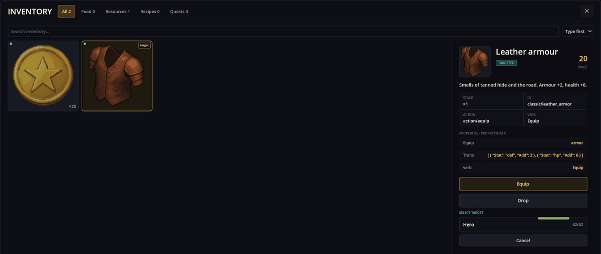
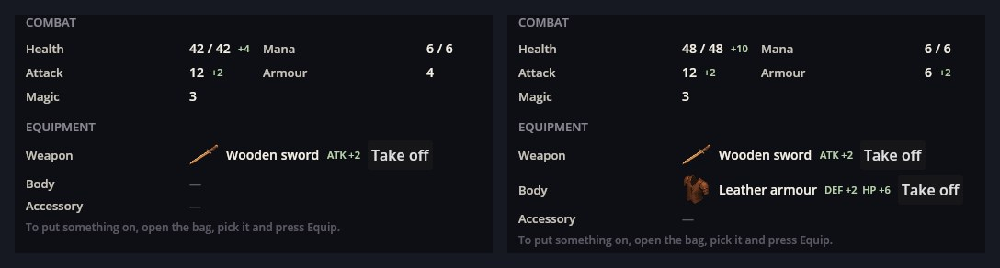

# Equipment — 캐릭터의 능력치를 바꾸는 장비

Equipment는 캐릭터가 물건을 착용하게 해 줍니다. 무기, 방어구, 부적 — 비주얼 노벨이라면 의상과 장신구도요. 아이템을 착용하는 동안 그 보너스는 캐릭터 능력치에 들어가므로, 캐릭터 시트, 전투, 능력치 판정, 조건이 모두 즉시 따라 바뀝니다. 벗으면 가방으로 돌아갑니다.

Stats Engine과 Items Base가 필요합니다. RPG Plus의 슬롯과 장비는 Classic RPG Rules 팩에서 오며, 다른 게임은 자기만의 것을 정의합니다.

## 물건 착용하기

가방을 열고 아이템을 고른 뒤 **Equip**을 누르고, 누가 착용할지 고르세요:



아이템은 가방을 떠나 캐릭터 시트의 **장비** 블록에 나타납니다. 착용 전과 후:



방어는 4에서 6으로 올랐습니다 — 방어구의 `def` +2죠. 체력은 42에서 48로: 기본 38에 방어구의 `hp` +6을 더해 44, 전사의 10% 체력 보너스가 48로 만듭니다.

- 시트의 **Take off**는 아이템을 가방으로 되돌립니다.
- 이미 찬 슬롯에 다른 것을 착용하면 원래 아이템이 가방으로 돌아갑니다.
- 고를 수 있는 것은 파티원뿐입니다.

## 아이템을 착용 가능하게 만들기

아이템 자신의 JSON에 있는 키 두 개만으로 장비가 됩니다. 아이템 모드는 이를 알 필요가 없죠. Classic RPG Rules의 가죽 방어구:

```json
{
  "Id": "classic/leather_armor",
  "Name": "classic/item/leather_armor/name",
  "ItemType": "TargetUsed",
  "ItemAction": "action/equip",
  "verb": "equipment/verb_equip",
  "Equip": "armor",
  "Traits": [ { "Stat": "def", "Add": 2 }, { "Stat": "hp", "Add": 6 } ]
}
```

- `Equip` — 아이템의 장비 종류. 슬롯을 결정합니다.
- `Traits` — 착용 중 무엇을 주는지. Stats Engine의 특성 형식(`Add`, `Percent`, `Formula`)으로 씁니다.
- `Archetypes`(선택) — 누가 착용할 수 있는지. 예: 오크 지팡이의 `["classic/mage"]`.
- `ItemType: TargetUsed`와 `ItemAction: action/equip` 조합이 장착 버튼과 대상 목록을 붙여 줍니다. `verb`가 버튼 글자를 정합니다.

## 슬롯

슬롯은 `equip_slot` 종류의 엔티티입니다. 각 슬롯은 받아들이는 장비 종류를 나열합니다:

```json
{
  "Kind": "equip_slot",
  "Items": [
    { "Id": "weapon", "Name": "classic/slot/weapon", "Order": 1, "Accepts": ["sword", "staff", "dagger"] },
    { "Id": "body", "Name": "classic/slot/body", "Order": 2, "Accepts": ["armor", "robe"] },
    { "Id": "accessory", "Name": "classic/slot/accessory", "Order": 3, "Accepts": ["charm", "ring"] }
  ]
}
```

`Accepts`가 없는 슬롯은 `Equip`이 자기 id와 같은 아이템을 받습니다.

## 능력치를 영구히 올리는 아이템

`\"ItemAction\": \"action/stat_up\"`에 `StatUp` 키 — 예컨대 `{"str": 1}` — 를 두면 사용된 파티원의 능력치가 영구히 바뀝니다. 강장제나 책 같은 셈이죠. 아이템은 소모됩니다.

## 시나리오에서

```scenario
action equip.put who=rpg_hero item=classic/wood_sword give=1
action equip.remove who=rpg_hero slot=weapon
when "equipped(rpg_hero, 'classic/wood_sword')" -> :armed
```

- `equip.put`은 가방에서 아이템을 착용합니다. `give=1`을 붙이면 대신 아이템을 지급하므로 가방에 없어도 됩니다. RPG Plus는 이 방식으로 직업마다 시작 무기를 줍니다. 여러 슬롯이 맞을 수 있으면 `slot=`으로 고릅니다.
- `equip.remove`는 슬롯에 착용된 것을 벗겨 가방으로 돌려보냅니다.
- 아이템이 착용되어 있는 동안 `equipped(who, 'item')`은 참입니다.

착용 상태는 게임에 함께 저장됩니다.

## 문제가 생겼을 때

1. **장착 후 고를 사람이 없음.** 대상 목록에는 파티원만 나옵니다. RPG Plus에서 영웅은 프롤로그 뒤 마을에 들어설 때 파티에 합류합니다.
2. **아이템을 착용할 수 없음.** 그 `Equip` 종류를 받는 슬롯이 없거나, `Archetypes`에 캐릭터의 직업이 없습니다.
3. **시트가 바뀌지 않음.** 아이템의 `Traits`가 게임이 정의하지 않는 능력치를 가리킵니다.
